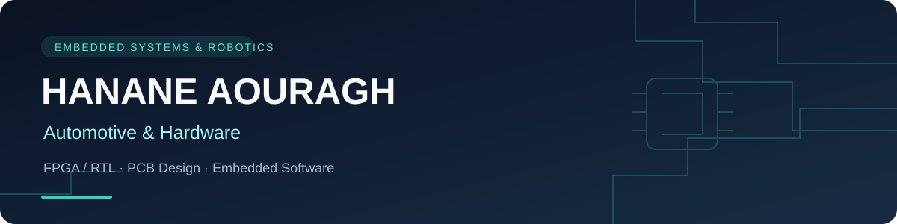

  

<h1 align="center">Hi, I'm Hanane 👋</h1>

  <strong>Master's Student in Embedded Systems & Robotics</strong> 
  Automotive applications · FPGA & RTL design · PCB design · Embedded software

  
  
  

---

### 👩‍💻 About me

I'm a second-year Master's student in **Embedded Systems and Robotics**, based in Morocco. My interests connect **automotive embedded applications** with **digital hardware design**, from microcontroller programming and sensor interfaces to FPGA verification and PCB layout.

I enjoy turning technical ideas into documented projects, with a focus on understanding the design, testing its behavior, and explaining the results.

🚗 **Automotive interests:** embedded electronics, monitoring, predictive maintenance, and system validation.  
🔬 **Hardware interests:** FPGA, RTL design, processor architecture, verification, and PCB design.  
🎯 **Looking for:** a six-month final-year internship (**PFE**) in 2027 in automotive or embedded hardware. Open to opportunities in **Morocco and France**.

---

### 🛠️ Technical skills

| Area | Technologies & tools |
| :--- | :--- |
| **Programming** | C, C++, Python |
| **Digital design** | Verilog, SystemVerilog, VHDL, FPGA, RISC-V |
| **Verification** | ModelSim, self-checking testbenches, reference-model scoreboards, UVM project experience |
| **Hardware & PCB** | KiCad, Quartus II, Proteus / ISIS |
| **Embedded platforms** | PIC16F887, ESP32, Arduino, Raspberry Pi |
| **Interfaces** | UART, AXI4-Lite, ADC |
| **Automotive & IoT project tools** | Edge Impulse, TinyML, Adafruit IO |
| **Development tools** | Git / GitHub, VS Code, MPLAB X, XC8, Arduino IDE, MATLAB |

---

### 🚀 Featured projects

#### 🚗 Automotive Predictive Maintenance — TinyML
Engine predictive-maintenance project using **TinyML / Edge Impulse**, **ESP32**, and **Adafruit IO** for an automotive monitoring application.

[Explore the project →](https://github.com/hananeaouragh-ops/Automotive-Predictive-Maintenance-TinyML)

#### 🔌 AXI4-Lite UART IP Core & USB-C to UART PCB
A project combining **Verilog RTL**, **AXI4-Lite**, UART TX/RX FIFOs, simulation-based verification, and a custom **two-layer KiCad PCB** based on the FT232RL.

- Self-checking Verilog testbench and UVM environment.
- FPGA synthesis completed; PCB design-rule check reported **0 errors**.
- **PCB fabrication and physical hardware validation are pending.**

[Explore the project →](https://github.com/hananeaouragh-ops/axi-uart-fpga-usbc-board)

#### 🧠 32-bit RISC-V Processor — RV32I + RV32M
A **five-stage pipelined processor** in SystemVerilog, featuring forwarding, load-use hazard detection, and multiplication/division support. The repository documents ModelSim simulation for the ALU and datapath.

[Explore the project →](https://github.com/hananeaouragh-ops/RV32I-RV32M-5-Stage-Pipelined-Processor)

#### 📦 Synchronous FIFO & Scoreboard Verification
An adaptation of an MIT-licensed FIFO design, extended with RTL compatibility improvements and a **plain-Verilog reference-model scoreboard**.

- Checks include full/empty conditions, simultaneous transfers, wraparound, and reset.
- Documented simulation: **1,068 cycles, 0 errors, PASS**.
- Quartus synthesis results included; physical-board validation is pending.

[Explore the project →](https://github.com/hananeaouragh-ops/synchronous-fifo-scoreboard)

---

### 🎓 Education

- **Master's in Embedded Systems and Robotics** — second year.
- **Bachelor's in Education, Industrial Sciences for Engineering** — ESEF Oujda, Mohammed First University, 2025.

---

### 🌱 Currently developing my knowledge

- Automotive communication and diagnostics: **CAN, LIN, UDS**.
- Real-time embedded software and **RTOS** concepts.
- Automotive development methods: **V-model, Agile, Automotive SPICE**.
- FPGA verification and the path from simulation to physical hardware testing.

---

  <strong>Interested in an automotive or hardware PFE opportunity?</strong> 
  Explore my repositories to see project documentation, simulation results, and design files.

